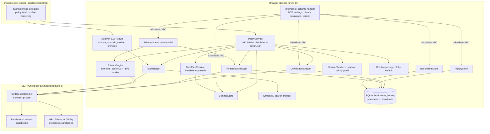

# Browser-x — Implementation Plan

Status: **Draft for review**. No code has been written. Nothing has been built, packaged, installed or deployed.
Target platform: **Windows** (x64 first).
Date: 2026-11-13

---

## 1. Executive summary

Browser-x is meant to be a lightweight desktop browser, inspired by Midori's minimal UX, running on Chromium, for Windows. It will have an IT-approved portable (install-free) mode.

**The repository is empty.** There is no existing code, framework, engine, build system, or instruction file to build on (see §2). Every choice below is a new decision, not an extension of existing work.

**Recommended architecture: Option B: a native Windows shell embedding CEF (Chromium Embedded Framework)**, built with CMake/MSVC in C++. The shell uses CEF's Views framework for the window, tab strip and toolbar. Internal pages such as the new-tab page, settings, history, downloads and the privacy panel are bundled `browserx://` pages, with a small IPC surface that only accepts allowlisted messages.

Why CEF and not a full fork:

- A Chromium fork (Option A) gives the full browser feature set: the full Chrome enterprise policy set, extensions and Safe Browsing integration. It also costs a lot. You need a checkout of more than 100 GB and multi-hour builds on large machines, and you have to rebase patches every 4 weeks. Teams that do this (Brave, Vivaldi, Edge) have dedicated staff for it. That is out of proportion for a "lightweight" MVP built from an empty repo.
- CEF ships prebuilt, versioned binaries that follow Chromium stable. Building against them takes minutes, not hours. It still uses Chromium's multi-process sandbox, Blink and V8, so website compatibility is the same as Chrome's.
- **CEF is not a full browser.** It does not provide Safe Browsing, sync, a full enterprise policy stack, a content blocker, an extensions UI, or an updater. Browser-x must build or deliberately leave out each of these. §7 lists the gaps.

Option C (an existing Chromium shell in the repo) does not apply, because none exists.

There is also a Windows-specific alternative worth a product decision: **WebView2** (§3.5). With the Evergreen runtime, Microsoft owns Chromium patching. That is very attractive for a small team, but it complicates truly install-free portable mode. See decision D1 in §10.

---

## 2. Repository findings

Inspection was done on branch `ccr-fcd9c72e-7xe7r1` against `origin` `https://github.com/condoriano98/Browser-x`.

| Area | Finding |
|---|---|
| Commits / history | **None.** `git log` reports "your current branch does not have any commits yet". `git ls-remote origin` returns no refs. |
| Files | **None** except `.git/`. This document is the first file. |
| `AGENTS.md`, `CLAUDE.md`, `README`, `CONTRIBUTING` | Not present. No repository instructions exist. |
| App framework | None. |
| Target OS | Not declared in the repo. The requester specified **Windows**. |
| Build system | None (no CMake, GN, MSBuild, package.json, Cargo, etc.). |
| Packaging | None (no WiX/MSIX/NSIS/zip scripts). |
| UI conventions | None. |
| Browser engine (Chromium / CEF / Electron / WebView2) | **None present.** |
| Settings / profile storage | None. |
| Update mechanism | None. |
| Code signing | None (no certs, signing scripts, or CI secrets referenced). |
| Policy handling (ADMX, registry, JSON policy) | None. |
| Tests / CI | None (no `.github/workflows`, no test dirs). |
| License | **No `LICENSE` file.** This must be decided before third-party code is vendored (§7.6). |

### Constraints that affect engine and packaging choices

1. **No team conventions to follow.** The first phase has to set them: language, build, layout, CI, code style, contribution rules (AGENTS.md).
2. **Windows-only target.** This removes cross-platform UI concerns. It also makes Authenticode signing, AppLocker/WDAC compatibility, ADMX policy templates, DPAPI-bound profile encryption and Mark-of-the-Web handling first-class requirements.
3. **No existing CI or build infrastructure.** A full Chromium fork would need large Windows build machines (32+ cores, 64 GB+ RAM, ~250 GB disk) that do not exist yet. CEF's prebuilt binaries avoid this.
4. **No signing identity exists.** The organization needs a code-signing certificate (OV/EV, or a managed service such as Azure Trusted Signing) before any build can be distributed, portable or installed.
5. **Name and branding.** "Inspired by Midori" should mean minimal UX only. Do not reuse Midori's name, logo or assets.

---

## 3. Engine options compared

### 3.1 Summary table

| Criterion | A. Full Chromium fork | B. CEF + native shell (**recommended**) | C. Existing shell in repo |
|---|---|---|---|
| Web standards / site compatibility | Same as Chrome | Same Blink/V8 as Chrome at the matching version. Minor gaps in browser-level features (e.g. some prompts and payment UIs) | N/A, none exists |
| Extensions | Full Chrome extension system | Partial and version-dependent. Must be verified in a spike. **Excluded from MVP** | N/A |
| Tab management | Chrome's, customisable via patches | Built by us (one browser view per tab). Full control, more work | N/A |
| Admin policy | Full Chrome policy stack, ADMX templates | CEF can read Chromium policies from a registry key we name (`chrome_policy_id`, Chrome-runtime only). **Many Chrome UI policies won't apply.** Shell-level policies are ours to implement | N/A |
| Security patching | We rebuild Chromium for every stable/security release (~weekly), and rebase our patches each milestone | CEF publishes builds within days of each Chrome stable. We bump the version, rebuild the shell (minutes) and re-sign | N/A |
| Build complexity | Very high: `depot_tools`, ~100 GB+ source, 4–12 h clean builds | Moderate: CMake + MSVC + prebuilt CEF. ~1–2 GB SDK, builds in minutes | N/A |
| Package size (estimate, to be measured) | 150–250 MB installed | ~250–350 MB unpacked (libcef.dll dominates), ~100–130 MB zipped | N/A |
| Memory | Chrome-like | Chrome-like per tab. The shell itself adds little. "Lightweight" comes from fewer background services, not a lighter engine | N/A |
| Windows feasibility | Yes (needs big build farm) | Yes. CEF's primary platform is Windows | N/A |
| Fit for an empty repo and a small team | Poor | **Good** | Not applicable |

### 3.2 Option A: full Chromium fork

- **Pros:** The most complete browser. All Chrome enterprise policies and ADMX templates come with it, along with extensions, Safe Browsing (with an API agreement), the profile system, password manager and download protection.
- **Cons:** Large ongoing staffing cost. Chromium cuts a new milestone every 4 weeks and security releases roughly weekly. Every downstream patch must be rebased, and a missed security release is a real exposure. It needs dedicated build infrastructure. The feature set is "lightweight" only in the UI.
- **When to choose it instead:** If product input (§10) decides that full Chrome-policy parity or extension support is a launch requirement. If so, consider starting from an existing de-Googled fork (e.g. ungoogled-chromium patches) rather than from scratch, and plan for at least one engineer working on rebases full-time.

### 3.3 Option B: CEF in a native shell (recommended)

- **Pros:** Real Chromium with the full multi-process sandbox, small build, fast security updates (bump the CEF version), and full control of the UI to get a Midori-like minimal design.
- **Cons and gaps we must own:** Safe Browsing, a content-blocking engine, the history/bookmarks/downloads UIs, permission prompts, the update system, the policy layer for shell features, and crash-report plumbing. Proprietary codecs (H.264/AAC) and Widevine are **not** in standard CEF builds. Adding them needs a custom CEF build plus licensing.
- **Do not assume** CEF provides Chrome's policy set, extension system or settings UI. Phase 0 includes a spike to measure exactly which Chromium policies take effect through `chrome_policy_id` on the chosen CEF branch.

### 3.4 Option C: existing Chromium shell

Not applicable. The repository contains no shell, engine or app.

### 3.5 Sidebar: WebView2 (decision D1)

WebView2 is Chromium-based and built into Windows 10/11 through the **Evergreen runtime**, which Microsoft patches.

- **Pros:** The smallest package (a few MB). Microsoft owns engine security updates. Organizations already manage it, and it has its own Edge-WebView2 policies.
- **Cons:** Truly portable use requires either the system Evergreen runtime (usually present, but IT-controlled) or a bundled **Fixed Version** runtime, which puts patching back on us. Browser-level features are no richer than CEF's.
- **Recommendation:** Keep CEF as the default plan. Decide D1 before Phase 1 starts, because if the organization accepts "portable = requires the system WebView2 runtime", WebView2 removes most of the security-patch burden.

---

## 4. Product scope

### 4.1 MVP features (first release)

| Feature | Notes |
|---|---|
| Tabs and navigation | New/close/reorder tabs, back/forward/reload/stop, tab restore (last closed), keyboard shortcuts (Ctrl+T/W/L/Tab, etc.). |
| Address/search bar | URL vs. query detection, a configurable search engine (no bundled commercial search deal), history/bookmark suggestions held **locally only**, no remote suggest by default. |
| Bookmarks | Add/edit/delete, folders, bookmarks bar, HTML import/export. |
| History | Local history, search, delete range/all, honors retention policy. |
| Downloads | List, open folder, cancel/retry, "ask where to save" setting, Mark-of-the-Web applied (§7.3). |
| Private windows | Separate in-memory `CefRequestContext`, no disk persistence, clear visual distinction. Can be disabled by policy. |
| New-tab page | Local static page: search box, top sites from local history, bookmarks. No remote content or ads. |
| Configurable privacy protections | Third-party cookie blocking (on by default), tracker blocking via filter lists (on by default, list licenses reviewed), HTTPS-Upgrade / HTTPS-Only mode, Global Privacy Control header, clear-data-on-exit option. |
| Site permission controls | Prompts for camera, mic, location, notifications, clipboard, pop-ups and downloads. Per-site settings page. One-click revoke. Defaults set by policy. |
| Privacy/status panel | Toolbar button per tab: connection security (TLS/cert info), blocked trackers count and list, active permissions, cookie counts, and whether the tab is private, plus a "managed by your organization" indicator when policy is applied. |
| No browsing telemetry | Nothing is sent home by default. No usage stats, no URL reporting, no remote experiments. See §7.5. |
| `browserx://version` | Shows the version, CEF/Chromium version, git commit, build ID, signing info, portable/installed mode, and applied policies (for IT verification). |

### 4.2 Explicit exclusions (later decisions)

| Excluded | Why / cost if added |
|---|---|
| Workspaces | UI and state complexity. Revisit after MVP feedback. |
| Extensions | CEF support is partial and version-dependent, the security review cost is high, and an admin allowlist pipeline is needed. Only the **policy hook** for "approved extensions" is designed in now (§6.6) so it can be added later. |
| Sync | Requires a server, account system, E2E encryption and a privacy review. |
| VPN | Out of scope for a browser MVP, and conflicts with corporate network controls. |
| Bundled search services / search partnerships | A business and privacy decision (§10). |
| Safe Browsing | Not in CEF. Needs an API agreement (Google Safe Browsing or Microsoft) and implementation. **Strongly recommended for v1.1.** See risk R3. |
| Password manager, autofill | Credential-storage security review needed. MVP relies on OS/enterprise password managers. |
| Proprietary codecs, DRM (Widevine) | Licensing and custom CEF builds. |
| macOS/Linux, ARM64 | Windows x64 first. ARM64 is a cheap follow-up because CEF ships it. |

---

## 5. Architecture

### 5.1 Component diagram



### 5.2 Proposed repository layout

```
/AGENTS.md                  contributor + agent rules (Phase 0)
/LICENSE                    project license (decision D5)
/CMakeLists.txt
/cmake/                     CEF download + checksum verification, toolchain
/third_party/cef/           (not committed) fetched by version + SHA-256
/src/app/                   entry point, sandbox bootstrap, process routing
/src/browser/               TabManager, windows, CEF handlers
/src/policy/                PolicyService, schema, ADMX generator
/src/storage/               DataPathResolver, SQLite stores, migrations
/src/privacy/               filter engine, cookie/HTTPS modes, panel model
/src/permissions/
/src/downloads/
/src/update/
/src/webui/                 browserx:// pages (HTML/CSS/TS, bundled as resources)
/policy/                    browserx.admx/.adml, policy schema JSON, docs
/packaging/msi/             WiX installer
/packaging/portable/        portable zip layout, launcher marker
/tests/unit/  /tests/integration/  /tests/e2e/
/docs/                      this plan, security, policy reference, release process
/.github/workflows/         build, test, sign, release
SECURITY.md  THIRD_PARTY_NOTICES (generated)
```

### 5.3 Key design rules

- **Never pass Chromium switches that weaken security.** `OnBeforeCommandLineProcessing` strips a denylist that includes `--no-sandbox`, `--disable-web-security`, `--disable-site-isolation-trials`, `--allow-running-insecure-content`, `--remote-debugging-port`/`--remote-debugging-pipe` (debugging is allowed only if policy permits), and `--disable-features=…` affecting isolation. Unit-tested.
- **Internal pages are privileged and isolated.** `browserx://` pages are never navigable from web content. They use a per-page message allowlist, and every IPC argument is validated.
- **One source of truth for paths.** Every write goes through `DataPathResolver`, so portable mode can be audited (§6.2).
- **Policy wins.** Every setting reads `PolicyService` first. A policy-controlled setting is shown locked with a "Managed by your organization" label.

---

## 6. Packaging and portable deployment

### 6.1 Two distribution forms, same signed binaries

| | Installed (MSI) | Portable (zip) |
|---|---|---|
| Audience | IT deploys via Intune / ConfigMgr / GPO | IT-approved scenarios: kiosks, restricted machines, test labs, admins' toolkits |
| Location | `%ProgramFiles%\Browser-x\<version>\` | Any IT-approved folder (e.g. a managed share or `D:\Apps\Browser-x\`) |
| Profile data | `%LOCALAPPDATA%\Browser-x\User Data\` | `<portable root>\Data\` |
| Updates | IT-managed (MSI upgrade) or optional updater | Side-by-side folders with rollback (§6.4) |
| Default-browser / protocol registration | Optional, via installer | **Never.** Portable mode does not touch file associations, the registry run keys, or system settings |

Both forms contain **identical, Authenticode-signed binaries**. The only difference is a signed marker file `portable.json` in the portable root. So AppLocker/WDAC publisher rules written for the installed product also cover the portable product, and IT stays in control of whether it may run.

### 6.2 Portable data directory and retention

```
Browser-x\                      portable root (IT-approved location)
  browserx.exe                  launcher (signed)
  portable.json                 signed marker: {"mode":"portable","data_dir":"Data"}
  App\
    1.2.0\  …                   current version (signed binaries)
    1.1.3\  …                   previous version kept for rollback
  current.json                  which App\<version> to run (written only by updater)
  Data\                         ALL user data lives here, visible, not hidden
    Profile\                    cookies, cache, local storage, SQLite stores
    Downloads\                  default download folder (configurable/policy)
    Crashpad\                   local crash dumps (never uploaded unless enabled)
    Logs\
  README-PORTABLE.txt           where data lives, how to delete it, how to verify
```

Rules:

- **Not hidden.** No hidden or system attributes, no alternate data streams, no writes to unexpected locations. `Data\` is a normal, visible folder.
- **Writes outside `Data\` are limited** to what Windows/Chromium need: `%TEMP%`, which is cleaned on exit where possible. Phase 4 tests audit this list and document it in README-PORTABLE.
- **Retention controls:** settings and policies for history retention days, clear-on-exit (cookies/cache/history/downloads list), and download-folder location. Private windows never write to `Data\Profile`.
- **Encryption caveat (documented):** Chromium protects cookies and saved secrets with DPAPI, which is tied to the Windows user. Copying a portable folder to another user or machine loses those secrets. That is intended, and the UI says so on first run. We do not weaken DPAPI binding to make profiles "more portable".
- **Removal:** deleting the portable root removes the product and all its data. The README lists any `%TEMP%` residue.

### 6.3 Behaviour when administrator policy disallows portable mode

Policy key: `HKLM\SOFTWARE\Policies\BrowserX\PortableModeAllowed` (DWORD). HKCU is consulted only if HKLM is absent and the organization's template allows user-level policy.

| Policy state | Behaviour |
|---|---|
| `PortableModeAllowed = 0` | Portable launch **stops before creating any browser process or writing any data**. A clear dialog says: "Your organization does not allow the portable version of Browser-x on this device. Please install the approved version from IT." It also shows a button that opens `PortableBlockedHelpUrl` (policy-set, e.g. the company portal) if configured. Exits with a documented code. The event is written to the Windows Application event log so IT can see it. |
| `PortableModeAllowed = 1` | Portable runs normally. |
| Not configured | Portable runs. Decision D3 asks whether the default should instead be "deny unless allowed" for managed builds. An org build can ship with `admin.json` setting the default to deny. |
| Host control blocks the exe (AppLocker, WDAC, SRP, Defender, EDR) | The browser does nothing to detect, evade or work around it. Windows' own block message is the outcome. Documentation tells users to contact IT. |

Browser-x will **not**: hide its process or window, rename itself, use alternate executables, skip or suppress policy, disable or tamper with endpoint protection, avoid logging, or offer "stealth" or "boss key" features.

### 6.4 Update and rollback

- **Installed:** IT-managed by default. MSI major upgrades with the same UpgradeCode. The optional built-in update *checker* only notifies, and `UpdateCheckEnabled` policy can turn it off. IT controls rollout rings.
- **Portable:**
  1. The update checker (policy-gated; off when `UpdateCheckEnabled=0` or `UpdateSource` points to an internal mirror) fetches a signed manifest over HTTPS.
  2. It downloads the zip and verifies the **SHA-256 from the signed manifest** and the **Authenticode signature of every PE file** against the pinned publisher.
  3. It extracts to `App\<new>\` side by side, runs a self-test launch (`--self-test` exits 0 if the sandbox and resources are OK), and then atomically rewrites `current.json`.
  4. It keeps the previous version. If launch fails, or the user picks "Roll back" in `browserx://version`, it reverts `current.json`. It keeps N=2 versions.
  5. Before profile schema migrations it backs up `Data\Profile\*.sqlite` to `Data\Backups\<old-version>\`.
- **Minimum-version policy:** `MinimumVersion` makes old builds show a "this version is no longer approved" message.
- **No silent self-updates** in portable mode unless `AutoApplyUpdates=1` is set by policy.

### 6.5 How IT verifies version and source

- **Authenticode** signature on every `.exe`/`.dll` we ship, timestamped. CEF/Chromium DLLs are signed by us as the distributor.
- **Published checksums:** `SHA256SUMS` plus a detached signature (Sigstore/cosign or minisign, decision D6), posted with every release.
- **Build provenance:** GitHub Actions build with SLSA provenance attestations (`actions/attest-build-provenance`), linking each artifact to its git commit and workflow run.
- **SBOM:** CycloneDX SBOM per release, including the exact CEF/Chromium version.
- **In-product:** `browserx://version` and `browserx.exe --version` (prints version, commit, CEF/Chromium version, and build ID). The Windows file version resource matches.
- **Pinned CEF input:** the CEF binary distribution is downloaded by exact version and verified against a committed SHA-256 before build.

### 6.6 Administrator configuration

- **Sources, in priority order:**
  1. `HKLM\SOFTWARE\Policies\BrowserX` (GPO/Intune via ADMX)
  2. `HKCU\SOFTWARE\Policies\BrowserX`
  3. `admin.json` next to the exe. Read-only, honored only if the file is signed, or if the folder is not user-writable (decision D4)
  4. User settings
- **Templates:** `browserx.admx/.adml` generated from a single policy schema (`policy/policy_schema.json`), plus Intune OMA-URI docs.
- **Chromium policies:** forwarded where CEF honors them, via `chrome_policy_id` → `SOFTWARE\Policies\BrowserX\Chromium`. The Phase 0 spike produces a **tested support matrix**. Unsupported policies are documented as such, never silently claimed.
- **MVP policy set:**
  - `PortableModeAllowed`, `PortableBlockedHelpUrl`
  - `PrivateBrowsingAllowed`
  - `DefaultSearchProviderUrl`
  - `HomepageUrl`/`NewTabPageUrl`
  - `URLBlocklist`/`URLAllowlist`
  - `DownloadDirectory`, `DownloadRestrictions`
  - `DefaultPermission_*` and `PermissionSiteList_*`
  - `ThirdPartyCookiesBlocked`, `TrackerBlockingMode`, `HttpsOnlyMode`
  - `ClearDataOnExit`, `HistoryRetentionDays`
  - `UpdateCheckEnabled`, `UpdateSource`, `MinimumVersion`
  - `CrashReportingEnabled`, `CrashReportUrl`
  - `RemoteDebuggingAllowed` (default off)
  - `ProxySettings` (or defer to system proxy)
  - `ApprovedExtensions` (reserved, no effect until extensions ship)
- **Host policies honored:** system proxy, the Windows certificate store and enterprise root CAs (Chromium uses them), Windows Defender SmartScreen via Mark-of-the-Web, and Windows Firewall. Nothing is disabled.

---

## 7. Security, policy, update and licensing

### 7.1 Chromium security update cadence and ownership

- **Owner:** a named **Release Security Owner** (decision D7), plus a backup.
- **Cadence:** follow CEF's builds of Chrome **stable**. Check daily, automated with a bot that opens a PR when a new CEF stable build appears.
- **SLA:**
  - Chrome releases marked as fixing an in-the-wild exploit: signed release within **72 h** of CEF availability
  - Other security releases: within **7 days**
  - Milestone bumps: within **14 days**
  - Never more than one milestone behind stable
- **Advisory:** each release note links the Chrome Releases post it includes.
- **End of support:** builds older than the current minus 1 are marked unsupported. `MinimumVersion` lets IT enforce this.

### 7.2 Sandbox requirements (non-negotiable)

- Ship with the Chromium sandbox **enabled** for renderer, GPU, network and utility processes. Use CEF's supported Windows sandbox integration for the chosen branch, either linking `cef_sandbox` into the executable or using CEF's bootstrap executable model on newer branches. This is confirmed in the Phase 0 spike.
- Site isolation stays at Chromium defaults.
- CI release gate: an integration test launches the browser and asserts that renderer processes run at Untrusted integrity / restricted token, using `browserx://sandbox` or the process token API. **A release is blocked if this fails.**
- `--no-sandbox` and similar switches are stripped and unit-tested (§5.3). There is **no** "compatibility mode" that disables the sandbox, in packaging or anywhere else.

### 7.3 Downloads, permissions and profiles

- **Downloads:**
  - Use Chromium's download path so Mark-of-the-Web / `IAttachmentExecute` attaches (verified in the Phase 3 test), letting SmartScreen and AV scan the file.
  - Show the full filename and extension, warn on dangerous types, and honor the `DownloadRestrictions` policy. Never auto-open executables.
- **Permissions:**
  - Everything is denied or prompted by default, there is no blanket grant, and grants are scoped per origin.
  - Prompts are attributed to the top-level origin and suppressed in background tabs.
  - Permissions granted in private windows are discarded on close.
- **Profiles:**
  - Profile directories are created with user-only ACLs (inherited from `%LOCALAPPDATA%` or the IT-approved portable folder).
  - Refuse to run a profile created by a newer version (no silent downgrade corruption).
  - A lock file prevents two instances on one profile.
  - SQLite runs with WAL and integrity checks on startup.

### 7.4 Dependency and license review

- **Inventory:** CEF (BSD-3), Chromium and its bundled third-party code (BSD, MIT, LGPL including FFmpeg, MPL, Apache-2.0, etc.), SQLite (public domain), filter-list data (EasyList/EasyPrivacy are GPLv3 / CC BY-SA 3.0 dual-licensed, which needs review for distribution terms), and any UI libraries.
- **Generate `THIRD_PARTY_NOTICES`** from CEF's `CREDITS.html` plus our own deps, and serve it at `browserx://credits`.
- **Do not ship** proprietary codecs or Widevine without a licensing decision (D8).
- **Dependency updates:** Dependabot/Renovate for our deps, and the CEF bump bot for the engine. A CycloneDX SBOM and OSV/vulnerability scan run on every release.

### 7.5 Crash reporting and telemetry defaults

- **Telemetry: none.** There is no usage metrics, URL collection, or experiments service. The only outbound requests the browser makes on its own are:
  - the update check (policy-gated)
  - filter-list updates (policy-gated, configurable source)
  - certificate revocation and checks Chromium does as part of TLS

  These are documented in `docs/network-requests.md` and verified by a Phase 4 test that records all traffic from a fresh profile on an idle new-tab page.
- **Crash reporting:**
  - Crashpad writes dumps **locally** to `Data\Crashpad` (portable) or the profile folder (installed).
  - Upload is **off** by default.
  - It can be enabled per user (opt-in dialog showing what is sent), or by IT pointing `CrashReportUrl` at an organization-owned server.
  - Dumps can contain page memory, so this is explained in the dialog.
- Google API keys and Google services (e.g. spelling service, translate) are not configured. Spellcheck uses bundled Hunspell dictionaries or is off.

### 7.6 Vulnerability reporting and release process

- **`SECURITY.md`:** private reporting via GitHub Security Advisories, 90-day disclosure, acknowledgement within 3 business days. Chromium/CEF bugs are forwarded upstream.
- **Release process (documented in `docs/release-process.md`):**
  1. CEF bump PR, with full CI (unit + integration + sandbox gate + network-request audit).
  2. Tag, then a reproducible CI build on a clean runner.
  3. Signing step on a protected environment (HSM/cloud signing, two-person approval).
  4. Generate the SBOM, provenance and `SHA256SUMS`, then sign the checksums.
  5. Publish the MSI, portable zip and signed update manifest.
  6. Release notes with CVE and Chrome-release links.
- **Rollback:** stop serving the update manifest and republish the previous version as current. Portable clients roll back locally (§6.4).
- **Project license (D5)** must be chosen in Phase 0 and be compatible with redistributing CEF/Chromium (permissive licenses such as BSD-3 or Apache-2.0 are simplest).

---

## 8. Phased implementation sequence and acceptance criteria

```
Phase 0 ─► Phase 1 ─► Phase 2 ─┬─► Phase 3 ─┐
                               └─► Phase 4 ─┴─► Phase 5 ─► Phase 6
```

### Phase 0: Foundations and spikes (no product code yet)

**Depends on:** decisions D1, D5, D7.

**Work:**
- AGENTS.md, LICENSE, SECURITY.md, coding standards, CMake skeleton, CI on `windows-latest` (build + empty tests).
- CEF fetch script with version pin and SHA-256 verification.
- **Spike 1:** minimal CEF window with the sandbox enabled.
- **Spike 2:** which Chromium policies work via `chrome_policy_id`.
- **Spike 3:** behaviour of the permission, download/MOTW and cookie/HTTPS preference APIs on the pinned CEF branch.
- **Spike 4:** measure package size and memory.

**Acceptance:**
- CI builds a signed-with-test-cert "hello" CEF app from a clean checkout.
- The sandbox gate test passes.
- A written spike report with a tested policy support matrix and measured size/RAM numbers.
- A go/no-go on Option B, recorded in `docs/adr/0001-engine.md`.

### Phase 1: Shell and navigation

**Depends on:** Phase 0.

**Work:** main window, tab strip, TabManager, toolbar, omnibox with search provider, keyboard shortcuts, `DataPathResolver` (installed mode), SettingsStore, command-line hardening, `browserx://` scheme with allowlisted IPC, `browserx://version`.

**Acceptance:**
- Open/close/switch 20 tabs without leaks (measured).
- Navigation, back/forward and reload work on a top-sites compatibility list.
- Dangerous switches are stripped (unit tests).
- Web content cannot navigate to `browserx://` (test).
- The version page shows the commit and CEF version.

### Phase 2: Data features

**Depends on:** Phase 1.

**Work:** SQLite stores and migrations, bookmarks (+ HTML import/export), history (+ retention), downloads UI, new-tab page, private windows (in-memory request context).

**Acceptance:**
- Data persists across restarts.
- A private window leaves no new files or rows in the profile (filesystem diff test).
- History retention purges correctly.
- The migration test upgrades a v0 database.

### Phase 3: Privacy and permissions

**Depends on:** Phase 2.

**Work:** PrivacyEngine (filter lists, third-party cookies, HTTPS-Only, GPC), PermissionManager with prompts and per-site settings, privacy/status panel, download safety (MOTW, dangerous-type warnings), clear-on-exit.

**Acceptance:**
- Tracker test page blocks expected requests.
- Third-party cookies are blocked by default (test site).
- HTTPS-Only upgrades or warns.
- Each permission type can be granted, denied and revoked, and private-window grants vanish.
- Downloaded `.exe` carries `Zone.Identifier`.
- The panel matches the actual state.

### Phase 4: Policy and portable mode

**Depends on:** Phase 2 (can run alongside Phase 3).

**Work:** PolicyService with all sources, ADMX/ADML generator, locked-setting UI, Chromium policy forwarding, portable marker and `Data\` layout, `PortableModeAllowed` enforcement with dialog and event log, write-location audit, network-request audit.

**Acceptance:**
- With `PortableModeAllowed=0`, portable mode shows the IT dialog, writes **zero** files, and starts no child processes (test).
- Every MVP policy has an automated test.
- ADMX loads in the Group Policy editor.
- The portable run writes only to `Data\` + `%TEMP%` (Process Monitor-based audit, documented).
- A fresh profile makes no unexpected network requests.

### Phase 5: Packaging, signing, update and rollback

**Depends on:** Phases 3 and 4, plus a signing certificate.

**Work:** WiX MSI, portable zip, signing pipeline, `SHA256SUMS` + signature, SBOM, provenance, signed update manifest, updater with side-by-side install and rollback, `--self-test`, `MinimumVersion`.

**Acceptance:**
- Every shipped PE file is validly signed (`signtool verify /pa` in CI).
- Checksums and provenance verify from the published docs.
- The MSI installs and uninstalls cleanly via Intune test tenant or ConfigMgr lab.
- Portable update A→B succeeds, a corrupted update is rejected, and rollback B→A works with an intact profile.
- `UpdateCheckEnabled=0` causes no update traffic.

### Phase 6: Hardening and release readiness

**Depends on:** Phase 5.

**Work:** external security review/pen test of the shell (IPC, scheme handler, updater), accessibility pass (keyboard, screen reader on the shell UI), crash-reporting opt-in flow, docs (user, IT admin guide, policy reference, network requests, portable README), first CEF-bump drill against the SLA.

**Acceptance:**
- No open high/critical findings.
- The CEF-bump drill meets the 72 h target end to end.
- The IT admin guide is reviewed by an actual IT/security stakeholder.
- 1.0 is signed off by the Release Security Owner.

---

## 9. Main risks and unknowns

| ID | Risk / unknown | Impact | Mitigation |
|---|---|---|---|
| R1 | CEF honors fewer Chromium enterprise policies than IT expects | IT adoption blocked | Phase 0 spike produces an exact matrix. Implement critical ones in the shell. Escalate to Option A if gaps are unacceptable |
| R2 | Security-patch SLA missed (small team) | Users exposed to known exploits | Named owner + backup, automated bump PRs, release drill, `MinimumVersion` policy. Or choose WebView2 Evergreen (D1) |
| R3 | No Safe Browsing in MVP | Weaker phishing/malware protection than Chrome/Edge | SmartScreen via MOTW for downloads. Schedule Safe Browsing for v1.1 (needs API agreement). Disclose in docs |
| R4 | Portable mode perceived as a "shadow IT" vector | Security-team rejection | Identical signed binaries (allowlist-friendly), `PortableModeAllowed` policy, event logging, visible data, no evasion features, IT verification docs |
| R5 | Package size (~100+ MB) conflicts with "lightweight" expectation | Product perception | Define "lightweight" as UI/background-service minimalism and measured RAM. Publish real numbers from Spike 4 |
| R6 | CEF API churn between branches (permissions, sandbox bootstrap, Chrome vs Alloy style) | Rework on bumps | Pin a branch, wrap CEF behind thin interfaces, keep integration tests broad |
| R7 | Filter-list licensing (GPL/CC BY-SA) | Distribution/legal issue | Legal review in Phase 3, or fetch lists at runtime from a source that IT can configure |
| R8 | DPAPI binding makes portable profiles non-transferable | User confusion | Document it and show a first-run notice. This is intended behaviour |
| R9 | No code-signing identity yet | Cannot distribute | Procure in Phase 0–1, so it is not on the Phase 5 critical path |

### Decisions requiring product or organizational input

| ID | Decision |
|---|---|
| D1 | Engine: CEF (recommended) vs. WebView2 Evergreen vs. full fork (A). Depends on patch-ownership capacity and whether portable may depend on the system WebView2 runtime |
| D2 | Default search engine and whether to offer search suggestions (privacy trade-off) |
| D3 | Portable-mode default when no policy is set: allow, or deny-unless-allowed |
| D4 | Whether `admin.json` must be signed by the organization, or only trusted when in a non-user-writable folder |
| D5 | Project license |
| D6 | Checksum signing method (Sigstore keyless vs. minisign/GPG key) |
| D7 | Who is the Release Security Owner and backup, and what patch SLA is committed |
| D8 | Proprietary codecs / DRM: needed? (licensing + custom CEF build) |
| D9 | Safe Browsing provider and timeline |
| D10 | Supported Windows versions (proposal: Windows 10 22H2 x64 and Windows 11 x64; confirm Win10 given its consumer end-of-support) |
| D11 | Final product name and branding (not "Midori") |

---

## 10. First implementation tasks

These are the first tasks after this plan is approved. None has been started.

1. **Record decisions D1, D5, D7, D10** in `docs/adr/` (engine, license, security owner, Windows versions).
2. **Bootstrap the repo:** `AGENTS.md`, `LICENSE`, `SECURITY.md`, `.gitignore`, `CMakeLists.txt`, and a GitHub Actions `windows-latest` build job.
3. **CEF fetch script** (`cmake/FetchCEF.cmake`) pinned to one CEF stable version with SHA-256 verification. The build fails on mismatch.
4. **Spike 1:** minimal sandboxed CEF window, plus the sandbox integrity-level test as the first CI release gate.
5. **Spike 2:** Chromium policy support matrix via `chrome_policy_id` → `docs/policy-support-matrix.md`.
6. **Spike 3/4:** verify the permission, download/MOTW and cookie/HTTPS APIs. Measure package size and idle/10-tab RAM → `docs/spike-report.md`.
7. **Draft `policy/policy_schema.json`** with the MVP policy set and `PortableModeAllowed` semantics from §6.3.
8. **Start code-signing certificate procurement** (long lead time).
